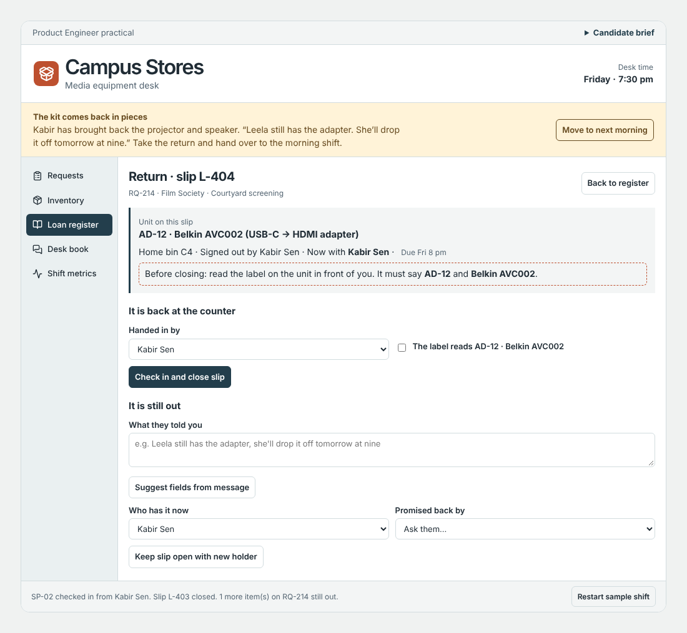
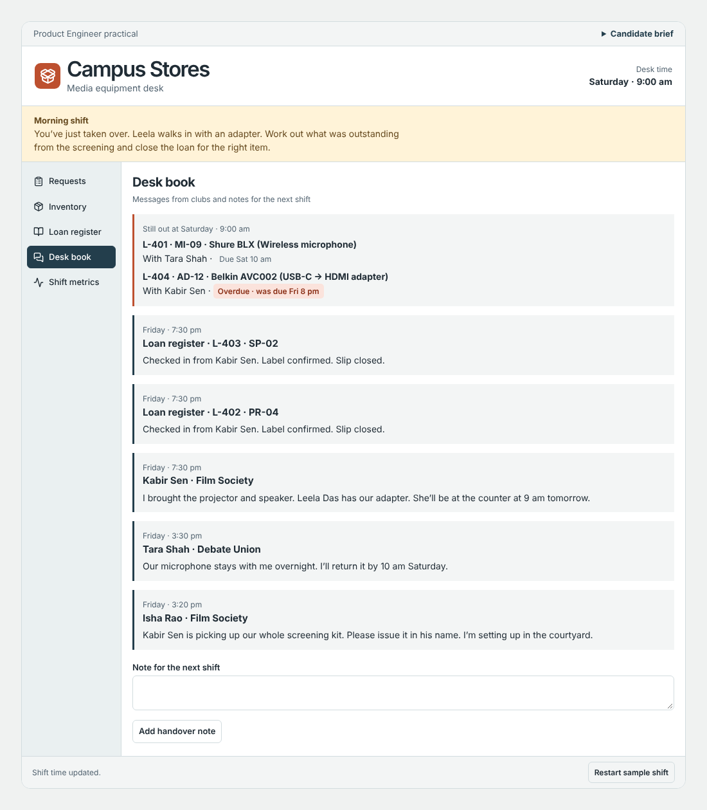
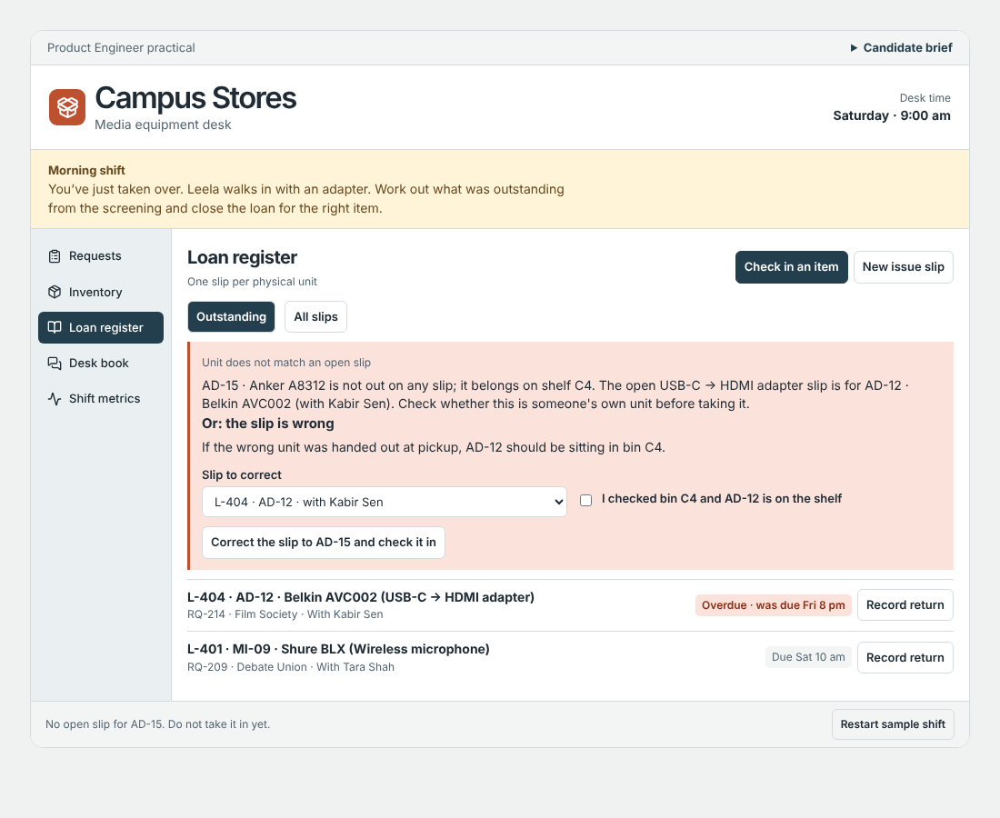
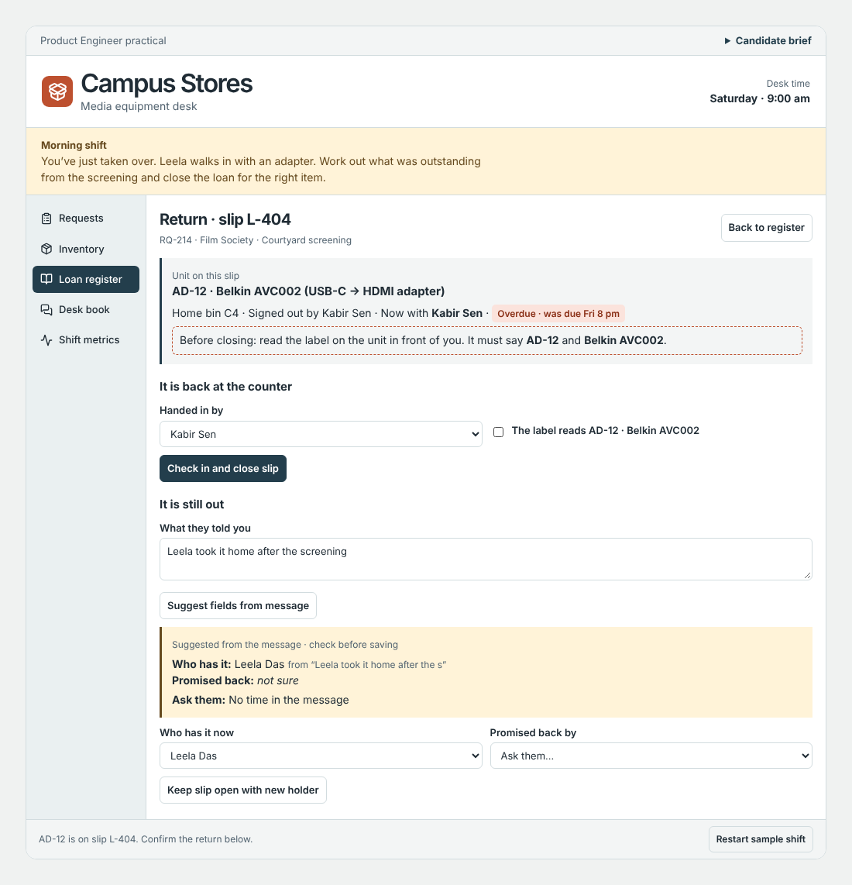
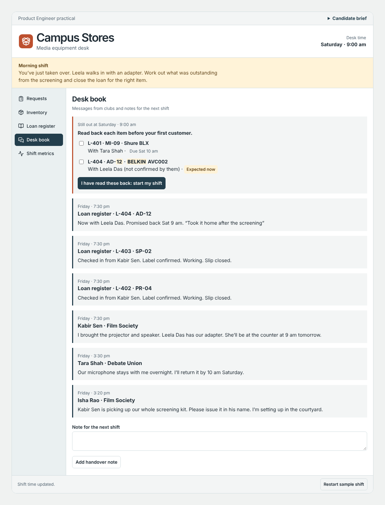
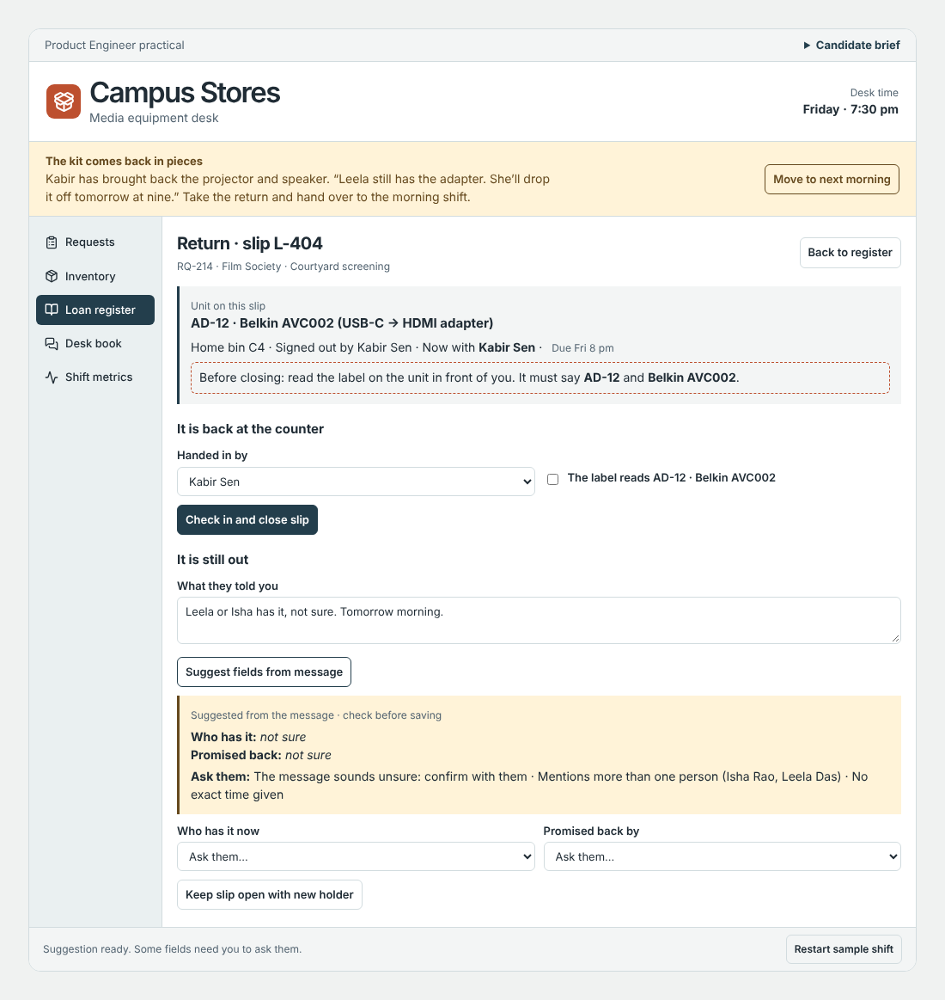
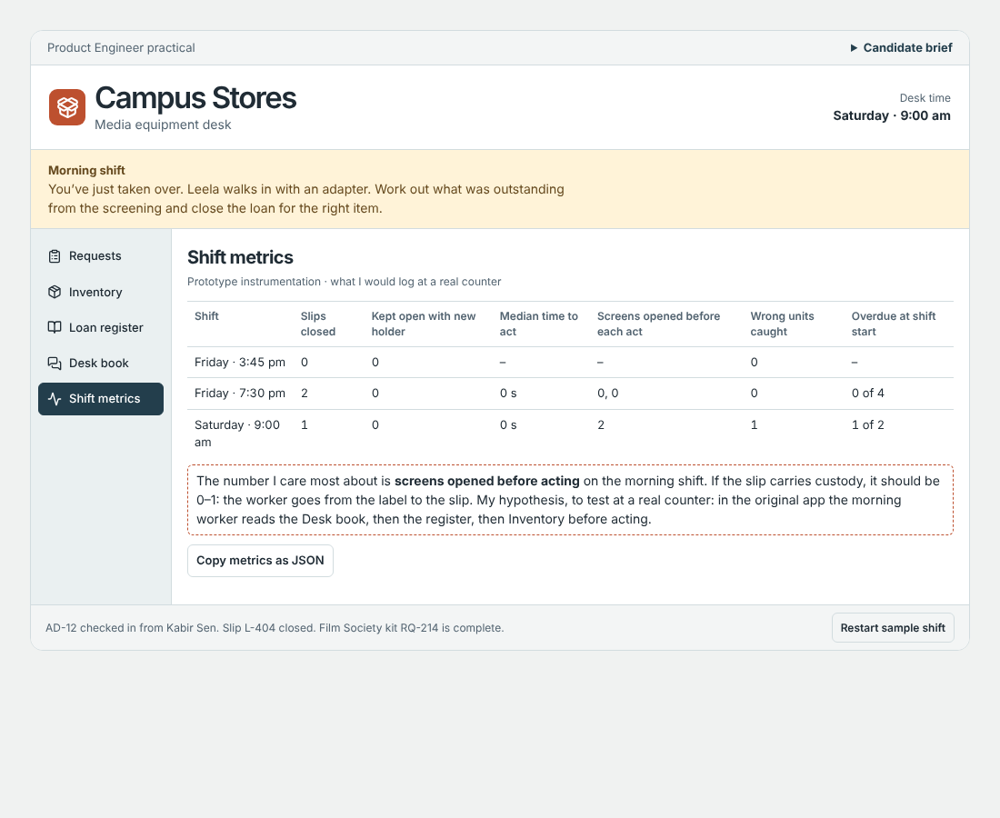

# Campus Stores

> **Reviewers: my submission is in [Would I keep this product?](#would-i-keep-this-product) below.**
> The prototype is on this branch. Open `index.html`, press **Restart sample shift**, and play the three moments.

## Would I keep this product?

**Yes, but I'd change one thing: how a slip handles a partial return.** The product is good at stopping the wrong thing from going *out*. It is weak at tracking what happens once a kit comes *back in pieces*.

### One moment it handles well: pickup
At 3:45 pm I issued PR-04, SP-02 and AD-12 to Kabir on RQ-214. Then I tried to add a second speaker, SP-05, "just in case". The form refused: *"The approved quantity of this equipment type is already on loan."* The projector in repair, PR-06, never appeared in the unit picker at all. So a counter worker under time pressure, with the film starting at four, can't hand out more than the club was approved for or a unit that's broken. **I kept this exactly as it is.**

### One moment I'd change: the 7:30 pm partial return and the 9 am handover
Kabir brought back the projector and speaker and said Leela had the adapter. In the original app, here is what I could and couldn't do:

| What happened in reality | What the original app could record |
|---|---|
| The adapter is now with **Leela**, not Kabir | Nothing. Slip L-404 still says Kabir, due **Fri 8 pm** |
| She promised **Sat 9 am** | Only as free text in the Desk book, not linked to the slip |
| Next morning, the adapter is 13 hours past its due time | No overdue flag. It still reads "Due Fri 8 pm" |
| Leela hands over "an adapter" | **Record return** closes the slip in one click, without checking which unit it is |

That last row is the real risk. There are **two adapters in the same bin, C4**: AD-12 (Belkin) and AD-15 (Anker). The register row said only "L-404 · AD-12", with no model name. A morning worker who never saw Friday can easily close the slip on the wrong unit, or take in Leela's personal adapter and lose ours.

The underlying problem is that **a slip records who signed for an item, not who has it now**, so a handover depends on someone remembering to write a note.

### The change: slips track custody, and returns start from the unit in hand
1. **"Record return" no longer closes a slip in one click.** It opens a return screen with two outcomes:
   - **It's back at the counter:** choose who handed it in, then tick *"The label reads AD-12 · Belkin AVC002"*. Only then does the slip close.
   - **It's still out:** record who has it now, when they promised it back, and what they said. The slip stays open.
2. **"Check in an item"** starts from the label on the unit, not from a name. If the unit has no open slip, the desk is told *not* to take it in and is shown which unit *is* expected and who has it.
3. **Every slip shows the model, who has it now, and whether it's Due / Expected now / Overdue** against the desk clock.
4. **The Desk book gets a "Still out" summary** at the top, and each custody change is posted there from the slip automatically. The free-text note is still there for anything else.
5. When the last item on a request comes back, the status bar says **"Film Society kit RQ-214 is complete."**
6. **"Suggest fields from message"** turns what was said at the counter into the "still out" fields, so the worker can check them before saving (see *Where AI fits* below).
7. **Undo return** reopens a slip closed by mistake during the current shift, and the slip's history keeps both the close and the undo.

And four additions taken from how hospitals and real equipment desks handle the same failure (see *What I borrowed, and from where* below):

8. **Read-back at handover.** On the morning shift, the Desk book asks the incoming worker to tick each item still out ("I have read these back: start my shift") before the first customer. The register shows a reminder until they do.
9. **Look-alike guard.** When two units of the same type share a bin (AD-12 Belkin and AD-15 Anker in C4), the number and brand are shown in bold capitals at issue, check-in and return: *AD-**12** · **BELKIN***.
10. **The new holder confirms.** When custody moves to Leela on Kabir's word alone, the slip says *"Not yet confirmed by Leela Das"*. It offers a ready-to-send WhatsApp/SMS message and a "Leela confirmed" button.
11. **Condition on return.** Working / Damaged / Part missing, with a note. A damaged unit shows as *Needs check* in Inventory and can't be issued again until someone clears it.

### The same job, using the change
- **Fri 3:45 pm, pickup.** Unchanged: three slips to Kabir, and the extra speaker is still blocked.
- **Fri 7:30 pm.** *Check in an item → PR-04 → handed in by Kabir → label ticked.* The same for SP-02. The status bar says *"1 more item on RQ-214 still out."* On L-404 I chose **Record return → It's still out**. I typed what Kabir said (*"Leela still has the adapter. She'll drop it off tomorrow at nine."*) and pressed **Suggest fields from message**. It filled in **Leela Das** and **Sat 9 am**, showing the words each came from. I checked them and saved.

  
- **Sat 9:00 am, a new person on shift.** The Desk book opens with *Still out: L-404 · AD-12 · Belkin AVC002, with Leela Das, Expected now* and Tara's mic, due at 10. I didn't need to read the whole thread.

  
- **Leela hands over an adapter.** I read the label. If it's **AD-15**, the app warns that this unit isn't out on any slip, and that the expected one is the Belkin AD-12 with Leela. I ask her before taking anything in. If the slip itself was wrong (AD-15 was handed out at pickup by mistake), the app asks me to check bin C4. If AD-12 is there, I can correct the slip and check AD-15 in. That correction is logged on the slip.

  
- If it's **AD-12**, "Handed in by" is already set to **Leela Das**. I tick the label, close the slip, and get *"Film Society kit RQ-214 is complete."*

  

### What I kept, and what I deliberately didn't change
- **Kept:** one slip per physical unit, the checks on approved type and quantity, the hidden in-repair unit, the Outstanding / All slips switch, and the free-text Desk book.
- **Not changed, on purpose:** issuing the whole kit in one go, and pre-filling the return time from the request. Pickup is annoying (three slips) but it doesn't produce *wrong records*; the partial return does. I'd look at pickup next.

### What I'd watch for at a real counter
**When the morning person checks in an item that went out the day before, do they ask a colleague, phone the club, or scroll the Desk book before acting?** If the change works, that should mostly stop: they go straight from the label to the slip. I'd also count slips that are reopened or corrected after closing. That number should drop to near zero for partial returns.

### What I borrowed, and from where
Hospitals already have this exact failure: information lost at shift change, look-alike items mixed up, items nobody can find. I reused their fixes rather than inventing new ones.

| Problem at the desk | Where the fix comes from | What I built |
|---|---|---|
| The morning shift skims a list and misses something | **I-PASS** handover method. Its last step is *synthesis by receiver*: the incoming clinician restates what they were told. A 9-hospital study (Starmer et al., *NEJM* 2014) found 23% fewer medical errors and 30% fewer preventable adverse events, without making handovers longer | Read-back checklist at the start of the morning shift |
| AD-12 and AD-15 look the same and sit in the same bin | **Tall Man lettering** for look-alike drug names (ISMP/FDA). The evidence on it is mixed, so I pair it with the label check rather than relying on it alone | Number and brand in bold capitals wherever look-alikes appear |
| "Leela has it" is only Kabir's word | Asset-tracking tools such as **Snipe-IT** ask the *recipient* to accept an item. Indian college libraries send due-date reminders over **WhatsApp** | Unconfirmed-holder flag, plus a ready-to-send message |
| A unit comes back broken and goes out again | Equipment-loan tools such as **Cheqroom** log condition on return | Condition field; the unit is kept off the shelf until checked |
| Closing the wrong slip | **Barcode checking at the bedside** cut non-timing medication errors by 41% (Poon et al., *NEJM* 2010). The label check is the no-scanner version of the same closed loop | "The label reads AD-12 · Belkin" tick, and check-in that starts from the unit |

Sources: [I-PASS, NEJM 2014 summary](https://reliasmedia.com/articles/134788-multicenter-quality-improvement-project-resulted-in-a-23-reduction-in-medical-errors) · [I-PASS handover time](https://www.clinician.com/articles/134526-study-new-approach-to-handoffs-slashes-errors-preventable-adverse-events-other-medical-centers-move-to-implement-the-protocol) · [Tall Man lettering](https://en.wikipedia.org/wiki/Tall_Man_lettering) · [Barcode eMAR, NEJM 2010](https://psnet.ahrq.gov/issue/effect-bar-code-technology-safety-medication-administration) · [Snipe-IT acceptance](https://snipe-it.readme.io/docs/requiring-acceptance) · [Cheqroom partial check-ins](https://help.cheqroom.com/en/articles/720823-handling-partial-check-ins-of-equipment) · [WhatsApp reminders in a Kochi college library](https://inkl.com/news/kochi-college-introduces-novel-initiative-of-integrating-whatsapp-with-its-automated-library-management-system)



### Evaluation: does the change actually make the records right?
One clean run of the shift proves very little, so I wrote 9 variants of it in `eval/run_eval.py`. In each one, something goes differently: the wrong adapter, someone else returns it, a skipped step, a misclick. The **same simulated counter worker** runs each scenario on the original app (upstream commit `aeeba26`) and on mine. Then the script compares the app's records with what physically happened.

```sh
pip install playwright && python -m playwright install chromium
python eval/run_eval.py
```

| Scenario | Check | Original | Mine |
|---|---|:---:|:---:|
| Scenario | Check | Original | Prototype |
| S1 · Leela returns the adapter at 9 am | Records correct overnight | ✅ | ✅ |
|  | Morning register shows who has it | ❌ | ✅ |
|  | Right slip closed | ✅ | ✅ |
| S2 · Leela hands in her own look-alike adapter | Personal adapter not taken as ours | ❌ | ✅ |
| S3 · Isha returns it instead of Leela | Right slip closed | ✅ | ✅ |
|  | Records who actually handed it in | ❌ | ✅ |
| S4 · Evening worker skips the handover step | Morning register flags it as late | ❌ | ✅ |
|  | Morning register shows who has it | ❌ | ❌ |
|  | Right slip closed | ✅ | ✅ |
| S5 · Adapter comes back with a bent connector | Damage recorded on return | ❌ | ✅ |
|  | Damaged unit kept out of the next issue | ❌ | ✅ |
| S6 · Wrong adapter was handed out at pickup | Mismatch between slip and unit surfaced | ❌ | ✅ |
|  | Records correct at end | ✅ | ✅ |
| S7 · Evening worker clicks Record return on the adapter by mistake | Records correct overnight | ❌ | ✅ |
| S8 · Control: mic and adapter both returned | Both slips closed | ✅ | ✅ |
| S9 · An empty case labelled AD-12 is checked in, then noticed | Records correct overnight | ❌ | ✅ |
| **Total** | | **6/16** | **15/16** |

**What the evaluation changed.** On the first run ([`eval/results-v1.md`](eval/results-v1.md)) my version scored **11/14** and *lost* S6 to the original. When the wrong unit had been handed out at pickup, my check-in correctly refused the unit. But it gave the desk no way to fix the slip, so the records stayed wrong. The original got this right only by accident: it closes whatever slip you click. I added the "the slip is wrong" path, which asks the worker to check the bin first, and S6 now passes ([`eval/results-v2.md`](eval/results-v2.md)). Later I added S9 (an empty case labelled AD-12 gets checked in) and an undo for it ([`eval/results-v3.md`](eval/results-v3.md)). Then I added condition on return, which fixed S5 ([`eval/results-v4.md`](eval/results-v4.md)).

**The failure I left, and why.** In S4, if the evening worker records nothing, no system can know Leela has the adapter. My version at least flags the slip as *Overdue* in the morning, so someone asks. The original shows nothing.

**A bug in my own evaluation.** In v3, S1 "Morning register shows who has it" failed for my version too. The app was fine, but the simulated worker clicked the first button in the "still out" form, which had become the new *Suggest* button, so the slip was never saved. v3 therefore understated my version by one check. I fixed the driver to click the form's submit button, and v4 is the corrected run.

**The main assumption, stated openly.** The simulated worker is honest but busy: **they check exactly what the screen asks them to check, and nothing more.** That favours my design, because the original never asks for a label check. A careful real worker would catch some of these cases in the original too. That is why the counter observation below matters more than this table.

### What real desks and nurses say (desk research, not my own observation)
I couldn't visit a counter before the deadline. Instead I read published rules from university equipment desks and nurses' forum posts about shift handover. They back up the problem, and one of them challenges my design:

- **Partial returns are a known, everyday problem.** Middlebury's circulation desk tells staff not to check in equipment with missing pieces. Instead they email the borrower and leave a note with the equipment, and every missing part takes a unit out of circulation. *([Middlebury Circ Services](https://sites.middlebury.edu/circservices/?p=4411))* My design keeps the slip open with a named holder, so that note doesn't depend on a scrap of paper.
- **Some desks simply forbid what happened in this shift.** One art college bans returning equipment for someone else or lending it on. *([CIA Equipment Checkout](https://cia.screenstepslive.com/a/2003675-equipment-checkout-policies))* Loyola refuses partial kit returns outright. *([Loyola DMS](https://www.luc.edu/its/dms/equipmentloan/loanprogrampolicies/check-insreturns/))* **This is the strongest argument against my design:** a rule is cheaper than software. My answer is that rules get broken at 7:30 pm when a screening has just finished, and a record of reality beats a record of the policy. I'd still want to test which approach loses fewer items.
- **A grace window for missing accessories is common.** UW–Stevens Point gives borrowers two business days to bring back a forgotten cord. *([UWSP](https://help.uwsp.edu/TDClient/66/Portal/KB/PrintArticle?ID=3532))* That's the same idea as my "promised back by" field.
- **Flagging broken units out of circulation is standard.** University of South Dakota's system makes a flagged item unavailable for checkout. *([USD](https://td.usd.edu/TDClient/33/Portal/KB/PrintArticle?ID=6923))* That matches my condition-on-return field and the *Needs check* status.
- **A second check catches desk errors.** One library discharges returned items twice, at the desk and again before shelving, to cut its own mistakes. *([Claims form](https://docs.google.com/forms/d/e/1FAIpQLSeSjBhBlG54cRZLFG3cml_v2GOkiT_gtjQbcKXgYG1Cl7cmiA/viewform))* That's the same idea as my label check plus the morning read-back.
- **Nurses describe the same handover failure.** On allnurses.com, nurses write that "things get missed" when handover is thin. A hospital that moved report to the bedside caught procedures the previous shift *thought* were done. *([allnurses](https://allnurses.com/patient-report-t704270), [Relias Media](https://www.reliasmedia.com/articles/122650-stop-errors-with-bedside-reports-at-change-of-shift))* That's why the morning read-back asks the incoming person to confirm each item, not just skim a list.

### Assumptions I'd test at a real counter
I haven't observed a real counter yet. These are **hypotheses, not observations**, and each one comes with the test I'd run:

1. **The evening and morning shifts rarely talk face to face, so the written record is the only handover.** *Test:* watch one shift change and note whether anything is said beyond what's written.
2. **Staff pick units by type ("the adapter"), not by label number.** *Test:* ask 3 staff to fetch "AD-12" and see whether they check the label or grab the first adapter.
3. **Partial returns happen often enough to matter.** *Test:* count slips with split custody (someone other than the signer has the item) over one week.
4. **Students reply faster on WhatsApp than to email.** *Test:* send the "new holder" message both ways and compare reply times.
5. **The main metric:** how many screens the morning worker opens before acting on a returned item. *Test:* watch 10 check-ins on each version. If my change works, it should drop to 0–1.

If assumption 1 or 2 turns out wrong, the read-back and look-alike features matter less, and I'd cut them before adding anything new.

### Where AI fits, and where I chose not to use it
**The decision:** I don't use a model to write or summarise the handover. The fix is **structured custody on the slip**: who has it, when it's promised back, and its history. A summary of free-text notes would be one more thing that can be wrong about which adapter is where. I use AI only at the point where free text comes in, which is **turning what someone says at the counter into the two "still out" fields**. The worker sees the suggestion, and the words it came from, before saving.

**How it works (`extract.js`).** You type or paste what Kabir said, then press **Suggest fields from message**. It returns `{ holder, promised, evidence, issues }`. Any field the message doesn't settle stays on **"Ask them…"**, and the reason is shown: unknown person, two names, no desk slot for that time, and so on. In this prototype it's a rule-based stand-in so the app still runs offline. The contract is the structured output I would ask an LLM for, and the evaluation set below is what I would run any model against before letting it replace the rules.



**Evaluation (`node eval/extract_eval.js`): 18 realistic counter messages, 36 fields.** Each field is graded as correct, *asked* (left empty with a reason, which is safe), *missed* (asked when the message was clear: costs time, but safe), or **unsafe** (filled in with the wrong value).

| Run | Correct | Asked (right to) | Missed | **Unsafe** |
|---|---|---|---|---|
| v1 ([results](eval/extract-results-v1.md)) | 25 | 7 | 2 | **2** |
| v2 ([results](eval/extract-results-v2.md)) | 27 | 8 | 1 | **0** |

- **The v1 unsafe errors:** *"Leela has AD-12, back tomorrow at ten"* became **Sat noon**, because the "12" in the unit label was read as a time. *"Around 10 or 11 tomorrow"* became **Sat 10 am**, when it should have asked. It also flagged "Das", Leela's own surname, as an unknown person.
- **What I fixed:** digits inside labels are ignored, more than one time now means it asks, and surnames count as known names.
- **What I left:** *"Tara has it? No wait, Leela has it"* still asks instead of guessing, which is safe. I didn't tune the rules to that one sentence.
- **Honest limit:** I wrote these messages *and* the rules, so 0 unsafe is a score on my own test. The real test is messages collected at a counter, run once, without changing the rules for them.

The **Shift metrics** page also counts how often the worker changes a suggestion before saving. Every changed suggestion is an extractor error, and goes into the evaluation set.

### Failure handling and privacy
- **Undo is append-only.** A slip closed during the current shift can be reopened with **Undo return**. The slip's history keeps both the close and the undo, so nothing is silently rewritten. Scenario S9 covers this.
- **Nothing closes on one click,** and the worker has to tick that the label matches before a slip closes.
- **Data kept on a slip:** a name from the desk's own list, times, and what they said. No phone numbers or roll numbers. In this prototype everything stays in the browser.
- **What a real version needs:** staff sign-in so every log entry records *which staff member* acted; students able to see only their own slips; a retention period for free-text notes, since they can contain personal details; and the history kept server-side where it can't be edited.

### Metrics built into the prototype
A **Shift metrics** page logs, for each shift: slips closed, slips kept open with a new holder, the median time from opening a return to finishing it, **screens opened before acting**, wrong units caught, and overdue slips at the start of the shift. There's a "Copy metrics as JSON" button. In a real pilot, these are the numbers I would compare between the two versions.



### How I used AI tools, and what I checked
I built this with Claude as a pair. These are the cases where checking the output changed the result:
- The first wrong-unit warning appeared only in the small status bar. I caught that on a screenshot, where it was easy to miss, and moved it to a red warning at the top of the register.
- The evaluation showed that my own design blocked a valid return (S6, above). I added the slip-correction path.
- An S6 check passed for the wrong reason. The red warning was still on screen *after* the slip was closed: stale UI. I fixed the app so the warning clears, and changed the check to look for the warning at the moment the unit is scanned.
- The metrics page originally stated my guess about the original app as fact. I reworded it as a hypothesis to test at a counter.
- The first version of the message extractor made 2 unsafe errors on its own evaluation set (read above). I fixed both before wiring it into the form.
- My evaluation driver had a bug that hid a pass in v3 (read above). The lesson: a test can be wrong in either direction, so I read the failures, not just the total.

### Implementation notes
- Changes are in `app.js`, `styles.css`, `index.html` (one icon and the `extract.js` script tag), plus the new `extract.js` and `eval/`. Storage moved to `campus-stores.shift.v2`, so old saved shifts start fresh.
- A slip now carries `holder`, `promised`, `returnedBy`, `returnedAt` and its own `log`. Times are compared as minutes on a shared Fri–Sat clock.
- I tested the full shift with a headless browser: pickup, the blocked extra speaker, the partial return, the wrong adapter, the right adapter, a reload that keeps the shift, and the mobile layout.

---

## About the exercise

Campus Stores is a Product Engineer work sample set at a fictional campus media equipment desk. Work through a club’s screening, from equipment pickup to a partial return and the next morning’s handover. Open **Candidate brief** in the app for the assignment.

## Run the app

Open `index.html` in a modern browser. The app includes its scripts, styles, and icons and can run offline.

To serve it over local HTTP, run this from the repository folder and visit `http://localhost:8000`.

```sh
python3 -m http.server 8000 --bind 127.0.0.1
```

Each browser stores its own sample shift locally when browser storage is available. **Restart sample shift** restores the fictional starting records.

## Source

- `index.html` contains the desk layout, candidate brief, and bundled icons.
- `app.js` contains the sample records and interactions.
- `styles.css` defines the desktop and mobile layouts.

Icon license notices are in [third-party/lucide-LICENSE.txt](third-party/lucide-LICENSE.txt).


## Submit your work

1. [Fork Campus Stores](https://github.com/virinchi-healthcare/campus-stores/fork) into your GitHub account. Complete the candidate brief and push your changes to your public fork. In your README, point reviewers to your work and explain the decision you made.
2. In your fork, open **Commits**, select the final commit you want reviewed, and copy the page URL. It should look like `https://github.com/YOUR-USERNAME/campus-stores/commit/COMMIT-SHA`.
3. [Submit your work through the Google Form](https://docs.google.com/forms/d/e/1FAIpQLScvzoh1R4WS-SkiwAVBQbMvniieJYSoOEfLMyVo5CyjOvYUgQ/viewform). Your **roll number**, **email ID**, and **final commit link from your public fork** are required. Enter your roll number and email ID in the form only.
